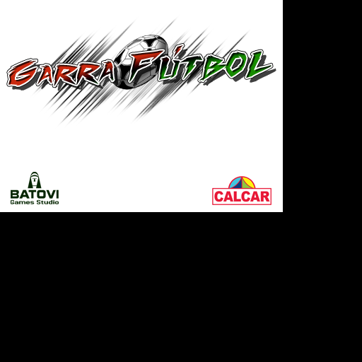

# Garra Fútbol Web

[](https://github.com/nahueldlsl/garra-futbol/actions/workflows/ci.yml)
[](https://www.typescriptlang.org/)
[](https://vitejs.dev/)
[](./LICENSE)

Port web **1:1** del clásico juego uruguayo **Garra Fútbol** (Batovi Games Studio), reconstruido desde cero en **TypeScript estricto**, **HTML5 Canvas 2D** y **Web Audio API**, sin dependencias de runtime.

<p align="center">
  
</p>

---

## Características principales

- **Fidelidad 1:1 al motor original (`SPECS.md`)**:
  - Viewport lógico de **400×300** (escalado limpio a `800×600` y responsive 4:3) con opción de píxeles nítidos o suavizados.
  - Bucle de simulación a **30 Hz fijos** (`FIXED_DT = 1 / 30`) con escalas de velocidad fieles (`Lento 0.65×`, `Normal 0.75×`, `Rápido 1.00×`, `Recontra rápido 1.15×`) y reloj de partido compensado en tiempo real.
  - **Proyección trapezoidal 3D → 2D** exacta, integrador cinemático 3D, física del balón (gravedad, fricción, arrastre aéreo, rebote, postes, travesaño y redes) y reglas completas de laterales, córners y saques de arco.
- **Modos de juego completos**:
  - **Copa Calcar** (torneo de 7 rondas con guardado persistente en `localStorage` y galería de ganadores).
  - **Amistoso**: `1P vs CPU`, `1P vs 2P` (local en el mismo teclado) y `CPU vs CPU`.
  - **16 equipos** con sus 11 jugadores, atributos individuales, descripciones y paletas de colores (`PaletteSwapper`), además de **3 formaciones** (`442`, `433`, `352`).
- **Audio original**:
  - Música y efectos `.ogg` reproducidos mediante **Web Audio API** con buses separados, control de silencio y desbloqueo automático en la primera interacción.

---

## Inicio rápido

### Requisitos

- [Node.js](https://nodejs.org/) 20 o superior (CI probado con Node 22)
- `npm`

### Instalación y ejecución

```bash
# 1. Instalar dependencias
npm install

# 2. Iniciar servidor de desarrollo
npm run dev
```

Abrí `http://localhost:5173` en tu navegador.

### Comandos disponibles

| Comando | Descripción |
| :--- | :--- |
| `npm run dev` | Inicia el servidor de desarrollo Vite |
| `npm run build` | Ejecuta `tsc --noEmit` y genera el bundle de producción en `dist/` |
| `npm run preview` | Sirve localmente el build de `dist/` |
| `npm run typecheck` | Verifica tipos con TypeScript en modo estricto |
| `npm run lint` | Ejecuta ESLint sobre `src/` |
| `npm run format` | Formatea el código con Prettier |
| `npm run format:check` | Comprueba el formato sin modificar archivos |
| `npm test` | Ejecuta `verifySimulation.ts` y la suite de pruebas unitarias (`src/**/__tests__/*.test.ts`) |
| `npm run check` | Ejecuta `typecheck` + `lint` + `format:check` + `test` |

---

## Controles

### Menús y Pausa

| Acción | Teclas |
| :--- | :--- |
| Navegar | `Flechas` (`↑` `↓` `←` `→`) |
| Confirmar / Aceptar | `Enter` o `Z` |
| Volver / Cancelar | `Escape` o `X` |
| Pausar partido | `Escape` |

### En cancha

| Perfil | Movimiento | Botón A (`shot`: tiro / barrida) | Botón B (`pass`: pase / cambiar jugador) |
| :--- | :--- | :--- | :--- |
| **1P vs CPU (Solo)** | `Flechas` | `Z` | `X` |
| **1P vs 2P — Jugador 1** | `D` (arriba), `C` (abajo), `X` (izq.), `V` (der.) | `Q` | `W` |
| **1P vs 2P — Jugador 2** | `Flechas` | `.` (`:` en teclado ES) | `-` (`/` / `_`) |

> **Mecánicas de disparo y pase:**
> - **Toque corto de Tiro**: disparo rápido raso (`kickLv1`), o **picarla** (`kickLv0`) si apuntás hacia atrás en zona de definición.
> - **Mantener Tiro**: carga potencia (`kickLv2` → `kickLv3` → `kickLv4` *Super Tiro*); mantené `↑` o `↓` al soltar para apuntar a los palos.
> - **Pase**: toque corto = pase raso; mantener un instante = pase alto / centro.
> - **Cabezazo**: presioná `Tiro` o `Pase` cuando el balón viene por aire.
> - **Sin balón**: `Tiro` = barrida; `Pase` = cambiar al jugador más cercano al balón.

---

## Arquitectura del proyecto

```text
├── index.html                  # Contenedor 4:3 del canvas y shell web mínimo
├── vite.config.ts              # Configuración Vite compatible con subpath (GitHub Pages)
├── SPECS.md                    # Especificación técnica de ingeniería inversa 1:1
├── scripts/
│   └── extract_assets.py       # Pipeline reproducible para assets y JSONs desde el juego original
├── public/
│   ├── favicon.png
│   └── assets/
│       ├── audio/              # Música y efectos (.ogg)
│       ├── images/             # Sprites, fondos y HUD (PNG/JPG RGBA)
│       ├── lang/               # Fuentes bitmap y pantallas de ayuda en español
│       └── manifests/          # Metadatos de atlas, fuentes y audio
└── src/
    ├── config/                 # Constantes físicas, proyección 3D->2D y resolución de URLs
    ├── core/                   # GameLoop, StateMachine, EventBus, DeterministicRNG
    ├── data/                   # DataRepository, tipos e información de equipos/menús/textos
    ├── domain/                 # MatchSimulation, BallPhysics, Collisions, RulesEngine, TacticalAI
    ├── entities/               # Entidades de partido (MatchState, Player, Ball, Team, Referee, math3d)
    ├── input/                  # InputManager con normalización diagonal 1/√2 y detección de flancos
    ├── rendering/              # AssetLoader, MatchRenderer, Camera, SpriteAnimator, PaletteSwapper, BitmapFontRenderer
    ├── audio/                  # AudioManager sobre Web Audio API
    └── ui/                     # AppController (máquina de estados de pantallas y menús)
```

---

## Pipeline de assets (opcional)

Los assets procesados ya se encuentran en `public/assets/` y `src/data/`. Si necesitás regenerarlos desde una extracción local del juego original, ejecutá:

```bash
python3 scripts/extract_assets.py --source /ruta/a/assets_extraidos
# o mediante variable de entorno:
GARRA_ASSETS_DIR=/ruta/a/assets_extraidos python3 scripts/extract_assets.py
```

---

## Créditos y Licencia

- **Juego original (*Garra Fútbol*)**: Batovi Games Studio — Producción Ejecutiva: Horacio Lagos, Fernando Sansberro · Producción, Diseño, Scripts, Arte y FX: Sebastián García · Programación y Motor Gráfico: Federico Medina, Nicolás Olhaberry · Música: Juan Fornos.
- **Código del port web**: distribuido bajo la [Licencia MIT](./LICENSE). Los assets gráficos, fuentes y audios originales en `public/assets/` y datos en `src/data/` pertenecen a **Batovi Games Studio** y se incluyen únicamente con fines educativos y de preservación.
